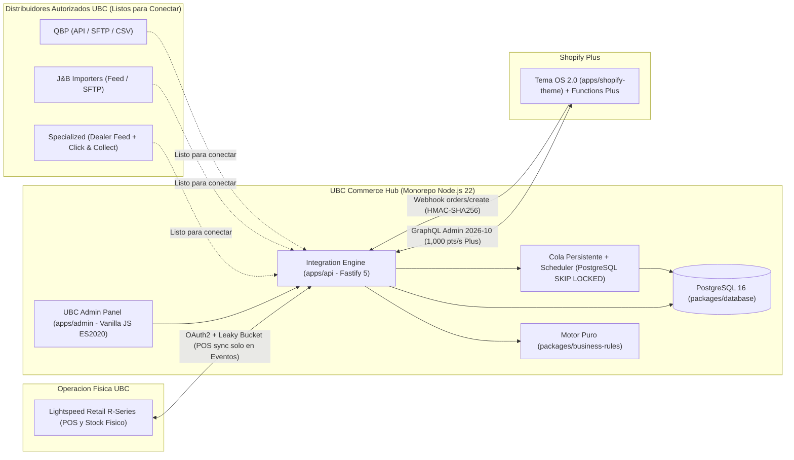
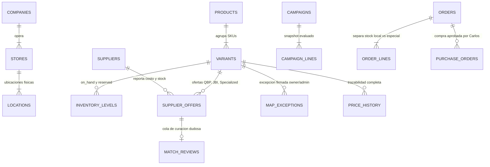
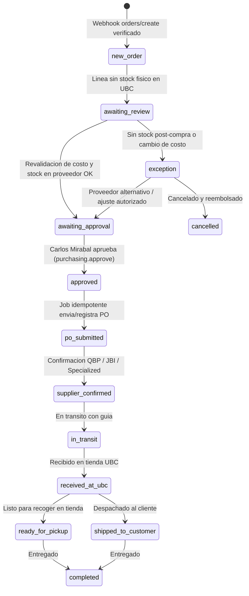

# Arquitectura Técnica y Plan de Ingeniería — UBC Commerce Hub

**Cliente:** University Bicycle Center (UBC)  
**Ingeniería y Arquitectura:** TwoIT Solutions LLC  
**Estado de Conectividad:** Arquitectura Plug-and-Play lista para conectar (`APP_MODE=demo` activo; credenciales preparadas en `.env.example`)

---

## 1. Decisiones Arquitectónicas Confirmadas con UBC

1. **Canal Ecommerce sobre Shopify Plus (`SHOPIFY_PLAN=plus`):**
   - Aprovecha la cuota ampliada de GraphQL Admin API (**1,000 pts/seg**), descuentos automáticos nativos (`discountAutomaticBasicCreate`), actualizaciones por lote (`productVariantsBulkUpdate`) y **Shopify Plus Functions** (*Delivery Customization* vía metafield `ubc.click_and_collect_only` para obligar **Recogida en Tienda** en bicicletas con restricción del fabricante como Specialized).
2. **Proveedores con Acceso Confirmado (Listos para Conectar):**
   - UBC ya dispone de cuentas activas de distribuidor al menos en **Specialized**, **JBI (J&B Importers)** y **QBP (Quality Bicycle Products)**.
   - Todos los adaptadores quedan implementados y listos para conectar en `packages/integrations/src/suppliers/connectors.ts` + importador de feeds en `packages/integrations/src/suppliers/csv.ts`, permaneciendo en modo seguro hasta cargar credenciales en `.env`.
3. **Paridad de Precios POS Selectiva (Solo Eventos Especiales):**
   - Por defecto, toda campaña promocional se ejecuta **únicamente online** (`channel = 'online'`).
   - La sincronización de precios con la caja registradora de **Lightspeed R-Series** (`channel = 'online_and_pos'`) se habilita **exclusivamente para grandes eventos comerciales** (`posEventType`: `black_friday`, `christmas`, `holiday_sale`, `annual_clearance`) y está protegida por la compuerta `LIGHTSPEED_R_POS_EVENT_WRITES_ENABLED`.
4. **Separación Estricta de Inventarios y Exactitud Financiera:**
   - Todo cálculo monetario usa **centavos enteros (`Cents`)** sin coma flotante.
   - **El stock físico de UBC y las ofertas de distribuidores nunca se suman** (`packages/business-rules/src/availability.ts`): en Shopify solo se promete como stock inmediato lo que existe físicamente en UBC; el catálogo de distribuidores habilita compra bajo **Pedido Especial** con metafields `ubc.availability=special_order` y `ubc.lead_time_days`.

---

## 2. Topología Real del Monorepo

### Estructura de Paquetes y Responsabilidades
| Ruta | Componente | Responsabilidad Técnica |
|---|---|---|
| `packages/shared` | Tipos de Dominio y RBAC | Centavos enteros, roles (`purchasing` para Carlos Mirabal), `ShopifyPlan`, `PosSyncEventType` y estados de pedidos. |
| `packages/business-rules` | Reglas Comerciales Puras | Evaluación de campañas, bloqueo duro MAP, piso de margen, restauración segura (`planRestore`), disponibilidad física vs. virtual, matching GTIN/MPN y transiciones de órdenes. |
| `packages/integrations` | Conectores Plug-and-Play | `ShopifyAdminClient` (Shopify Plus), `LightspeedRClient` (R-Series API v3 + Leaky Bucket + precios de evento POS), `liveQbp`/`liveJbi`/`liveSpecialized` y parser CSV. |
| `packages/database` | Persistencia y Migraciones | Migraciones transaccionales con `pg_advisory_lock`, pool PostgreSQL 16, hashing `scrypt` y seed determinista DEMO. |
| `apps/api` | Integration Engine | Servidor Fastify 5, sesiones `httpOnly` + CSRF, endpoints REST, webhooks idempotentes y worker de trabajos asíncronos. |
| `apps/admin` | Panel de Carlos Mirabal | SPA rápida sin frameworks pesados (HTML + CSS + Vanilla JS ES2020 compatible con escritorio e iPhone). |
| `apps/shopify-theme` | Storefront UBC | Tema Shopify Online Store 2.0 validado con Theme Check, badges de pedido especial y tiempos de entrega. |

---

## 3. Modelo de Datos y Garantías Transaccionales

Además del esquema relacional de referencia documentado en `database/schema.sql`, el motor productivo opera con las siguientes tablas multi-empresa (`company_id`):

---

## 4. Reglas de Sincronización: `Lightspeed R-Series ↔ Hub ↔ Shopify Plus`

### 4.1. Matriz de Fuente de Verdad y Frecuencias
| Dominio | Fuente de Verdad | Destino | Regla Operativa |
|---|---|---|---|
| **Inventario físico** | Lightspeed R-Series | Hub → Shopify Plus | Lectura paginada incremental (`timeStamp=>...`), excluyendo `shopID=0` y descontando `reserved` + `physicalSafetyQty`. |
| **Ofertas de distribuidores** | QBP / JBI / Specialized | Hub → Metafields Shopify Plus | Nunca se suman al stock físico; activan venta bajo pedido especial si la oferta es fresca (`<= maxOfferAgeHours`) y supera `supplierSafetyQty`. |
| **Precios regulares y campañas** | UBC Commerce Hub | Shopify Plus (+ Lightspeed POS **solo en eventos**) | Campañas normales usan `channel='online'` (descuento automático nativo si es uniforme, o actualización de variantes con snapshot). Eventos como **Black Friday** o **Navidad** activan `channel='online_and_pos'` + `posEventType`. |
| **Órdenes web** | Shopify Plus | Hub → Bandeja de Compras | Webhook `orders/create` validado con HMAC-SHA256 sobre buffer crudo e idempotencia en `sync_events`. |

### 4.2. Estrategia Inteligente de Ejecución de Campañas
El motor (`chooseExecutionStrategy` en `packages/business-rules/src/pricing.ts`) elige automáticamente el mecanismo óptimo:
1. **Campaña cotidiana (`channel = 'online'`) con descuento uniforme sin recortes por margen:** Crea un `discountAutomaticBasicCreate` nativo en Shopify Plus sin tocar el precio base del catálogo; al vencer se desactiva limpiamente.
2. **Campaña con redondeo `.99`, recortes por margen mínimo o Evento Omnicanal (`channel = 'online_and_pos'` en Black Friday / Navidad):**
   - Exige **Token de Vista Previa (`previewToken`)** al aprobar: si cambió un costo o MAP antes del clic de aprobación, devuelve `409 PREVIEW_STALE`.
   - Aplica precios con **bloqueo optimista** (`WHERE price_cents = old_price_cents`).
   - Si es un evento `online_and_pos` y `LIGHTSPEED_R_POS_EVENT_WRITES_ENABLED=true`, sincroniza los precios hacia Lightspeed R-Series respetando el *leaky bucket* (`X-LS-API-Bucket-Level`).
   - Al finalizar el evento, `planRestore` revierte precios tanto en Shopify Plus como en Lightspeed POS, omitiendo (`skipped_changed`) cualquier producto cuyo precio haya sido editado manualmente después.

---

## 5. Conectores de Distribuidores (QBP, JBI, Specialized)

1. **Deduplicación en 3 niveles (`packages/business-rules/src/matching.ts`):**
   - Coincidencia exacta por **UPC/EAN/GTIN** normalizado → enlace automático a la variante existente.
   - Coincidencia exacta por **Marca + MPN** → enlace automático.
   - Coincidencia parcial/difusa → envía a `match_reviews` para aprobación visual en el panel antes de publicar.
2. **Selección del Proveedor Óptimo:** Prioriza menor costo mayorista en centavos, disponibilidad sobre el colchón de seguridad (`supplierSafetyQty`), frescura del reporte y menor tiempo de entrega (`leadDays`).
3. **Reglas de Marca y Click & Collect en Shopify Plus:**
   - Para bicicletas completas de marcas con restricción de envío directo (ej. **Specialized** con `SPECIALIZED_BIKES_PICKUP_ONLY=true`), el Hub escribe `ubc.click_and_collect_only = true` en la variante para que la *Shopify Plus Delivery Customization Function* ofrezca únicamente **Recogida en Tienda UBC**.
   - Ninguna descripción o imagen de proveedor se publica si `content_licensed = false`.

---

## 6. Máquina de Estados de Pedidos Especiales

---

## 7. Checklist de Activación a Producción (Cuando UBC decida conectar)

1. Copiar `.env.example` a `.env` en el servidor productivo (con PostgreSQL 16).
2. Completar credenciales de **Shopify Plus** (`SHOPIFY_SHOP_DOMAIN`, `SHOPIFY_ADMIN_ACCESS_TOKEN`, `SHOPIFY_WEBHOOK_SECRET`) y validar en tienda dev antes de activar `SHOPIFY_WRITES_ENABLED=true`.
3. Completar OAuth2 de **Lightspeed R-Series** (`LIGHTSPEED_R_CLIENT_ID`, `LIGHTSPEED_R_CLIENT_SECRET`, `LIGHTSPEED_R_REFRESH_TOKEN`, `LIGHTSPEED_R_ACCOUNT_ID`) manteniendo `LIGHTSPEED_R_POS_EVENT_WRITES_ENABLED=false` salvo cuando se autorice sincronizar precios de eventos (Black Friday / Navidad).
4. Vincular las credenciales/feeds de **QBP**, **JBI** y **Specialized** provistas por las cuentas ya existentes de UBC.
5. Activar `APP_MODE=live` junto con `LIVE_MODE_ACK=I_UNDERSTAND_THIS_CONNECTS_REAL_SYSTEMS`.
